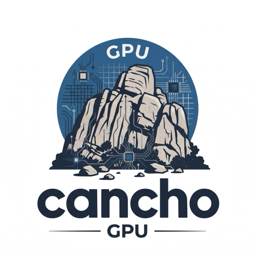

<p align="center"></p>

# cancho-gpu

[](https://github.com/alpibrusl/cancho-gpu/actions/workflows/ci.yml)

**A GPU kernel compiler that says what it can do.** [lex-gpu](https://github.com/alpibrusl/lex-gpu)'s `.lx` tile-kernel compiler, written in [cancho](https://github.com/alpibrusl/cancho): it checks a typed tile program (linearity, bounds, shapes, the threadgroup budget) and lowers it to **CUDA C** and **Metal**, byte-for-byte what lex-gpu's Rust emitter writes. It links nothing but libc, and `cancho authority`, checked in CI, names what it may do: read and write files, print, allocate; never the network, never foreign code. The [project page](https://alpibrusl.github.io/cancho-gpu/) has the summary.

**Status: it runs a language model on a Metal GPU (Qwen2.5-0.5B, agreeing with Hugging Face transformers); the compiler, the device path, the model-reading core and the decode kernels are built; larger models, serving, long-context attention and AMD are open.** CUDA has been run only against a mock driver (no machine here has an NVIDIA GPU); Metal has run on Apple Silicon. Slice 9a is complete: GGUF and safetensors headers, a BPE tokenizer and a sampler, each held to an oracle on fixtures and real files. Slice 9b has rope, kv_append, attention and an output gate in `.lx`; attention over more than 1364 cached positions (split-KV) cannot be written in the surface yet (below).

## What you get

* **The same bytes as the Rust.** CUDA C and Metal for every emitting case of `tests/cases.txt` (159 cases: 133 emit, 26 are refused by both compilers) are byte-identical with lex-gpu's emitter, and a refusal names its rule ([`docs/rules.md`](docs/rules.md)). The goldens are recorded from the Rust, never from this compiler.
* **A reference interpreter.** `--run` interprets a kernel on the CPU and prints the same summary as the Rust's, f32 order included (24 runs).
* **A way to drive a GPU.** A C shim and a device program compile the emitted kernel with NVRTC (CUDA) or `newLibraryWithSource` (Metal), upload the interpreter's inputs, launch, and compare ([`docs/device.md`](docs/device.md)).
* **A model reader.** `gguf` and `safetensors` read a header (names, shapes, offsets, metadata) and refuse hostile bytes with a rule tag; `tokenize` is a byte-level BPE tokenizer and `sample` a temperature/top-k/top-p sampler. Each prints a canonical text that an oracle prints too: GGUF and the tokenizer from lex-rt, safetensors from the `safetensors` library, the sampler from lex-rt. Identical on every fixture and on real files: five GGUF models, 2,180 + 1,199 safetensors tensors of Qwen3.8-27B, four real tokenizers over 3,811 records. The sampler's picks and ids are identical and 99% of its probabilities bit-identical (macOS's `expf` differs from the correctly rounded one in 0.6% of inputs) ([`docs/runtime.md`](docs/runtime.md)).
* **Decode kernels for an attention layer.** `rope.lx`, `kv_append.lx`, `attention.lx` and `attn_gate.lx` for Qwen3.8-27B's full-attention layers, byte-identical with lex-gpu's emitter and interpreter, checked against a reference for what they compute, and run once on a Metal GPU ([`docs/kernels.md`](docs/kernels.md)).
* **It runs a model.** `cancho-gpu-run` loads a Qwen2 checkpoint, tokenizes a prompt, runs every layer as compiled `.lx` kernels on a Metal GPU and samples the next token: Qwen2.5-0.5B gives the same 12 greedy tokens as transformers in float32 on three prompts, with every top-5 logit within 1e-4, at about 35 ms a token before any tuning ([`docs/inference.md`](docs/inference.md)).
* **An authority you can read.** The compiler performs `args`, `err_write`, `fs_read`, `fs_write`, `heap`, `io_write` and nothing else; the device program is the one that calls foreign code, and says so.

How it is built, what it cost and what the language made hard: [`docs/design.md`](docs/design.md).

## Requirements

- The **cancho** compiler at the commit pinned in `cancho.toml`; the revision is part of the contract.
- Rust, to build that compiler.
- To run the tests: `python3` (fixtures, fuzzing, the kernel reference) and a C compiler (the device plumbing).
- Only to regenerate the goldens or run the live differential: a [lex-gpu](https://github.com/alpibrusl/lex-gpu) checkout and `cargo`.

## Quick start

```sh
git clone https://github.com/alpibrusl/cancho
git clone https://github.com/alpibrusl/cancho-gpu && cd cancho-gpu

REV=$(sed -n 's/^cancho = "\([0-9a-f]*\)".*/\1/p' cancho.toml)    # the revision CI uses
(cd ../cancho && git checkout "$REV" && cargo build --release -p cancho)
export CANCHO=$PWD/../cancho/target/release/cancho

$CANCHO build                         # build/cancho-gpu
mkdir -p out
build/cancho-gpu emit tests/lx/lex-gpu/gemm_fp4.lx out m=128 n=128 k=64
```

## Examples

**Emit a kernel** for every target the file has a schedule for:

```
$ build/cancho-gpu emit tests/lx/lex-gpu/gemm_fp4.lx out m=128 n=128 k=64
out/gemm_fp4_128_128_64_128_128_64.cu: 256 threads, grid 1x1, 36864 B of tiles
out/gemm_fp4_128_128_64_64_128_32.metal: 256 threads, grid 2x1, 12288 B of tiles
```

**Check it, and run it on the CPU:**

```
$ build/cancho-gpu check tests/lx/lex-gpu/rmsnorm.lx n=4096 eps=1e-5 --run
```

**A refusal names its rule:**

```
error[use-after-move]: `x.0` used after it was moved
```

**Read a model's header** (the same text lex-rt's reader prints; `--sum` adds a checksum of each tensor's bytes):

```
$ build/cancho-gpu gguf tests/gguf/tiny.gguf --sum
gguf v3 tensors=6 kv=31 alignment=32
kv general.architecture str "llama"
kv arr.strs array n=5 [str "a", str "bb", str "ccc", str "", ...]
tensor blk.0.ffn.weight type=Q8_0 dims=[64] bytes=68 sum=40d93799
...
```

**Read a safetensors header, tokenize, sample** (each against its oracle's output in `golden/`):

```
$ build/cancho-gpu safetensors tests/safetensors/mlx-like.safetensors
safetensors header=312 tensors=4 data=224
meta format "mlx"
tensor layer.biases F16 shape=[8,1] range=[144,160]
...
$ build/cancho-gpu tokenize tests/tokenizer/toy-pairs.json tests/tokenizer/corpus.txt
tokenizer ids=862
ids 7: 72 101 399 111 44 723 33
dec "Hello, world!"
...
$ build/cancho-gpu sample tests/sampler/vocab-2.f32 2 1.0 0.95 20 7
row 0 pick 1 nucleus 2: 1=3f6922c8 0=3db6e9c3
...
```

**Run a kernel on a GPU** against the interpreter (needs a GPU, and is not part of the gate):

```sh
CANCHO=$CANCHO scripts/build-device.sh        # CUDA: build/cancho-gpu-device
CANCHO=$CANCHO scripts/build-metal-device.sh  # Metal: build/cancho-gpu-metal-device
```

**See what it is allowed to do** (checked by `tests/authority.sh`, in the gate):

```sh
$CANCHO authority --std src/*.cho
# performs: args, err_write, fs_read(""), fs_write(""), heap, io_write
# never touches: the network, signals, other programs, foreign code
```

## Checking it

```sh
CANCHO=$CANCHO scripts/gate.sh               # format, file budget, build, unit tests, goldens, refusals, device plumbing, GGUF, safetensors, tokenizer, sampler, kernels, authority
scripts/differential.sh ../lex-gpu           # the same cases against a live build of the Rust
scripts/regen-golden.sh ../lex-gpu           # golden/ from the Rust, never from this compiler
scripts/regen-gguf-golden.sh ../lex-gpu      # golden/gguf/ from lex-rt's reader (also regen-tokenizer-golden.sh, regen-sampler-golden.sh, regen-safetensors-golden.sh, regen-unicode-data.sh)
CANCHO=$CANCHO scripts/model-check.sh <model dir>  # run a checkpoint on the Metal GPU and compare with transformers (needs a Mac, torch)
CANCHO=$CANCHO scripts/metal-kernels.sh      # the 9b kernels on a Metal GPU against the interpreter (needs a Mac)
```

`tests/lx/lex-gpu/` holds lex-gpu's own `.lx` kernels, copied at the commit in `golden/LEX_GPU`; `tests/lx/` holds programs written here for the lowering paths those do not reach (`softmax.lx` is the first kernel that needs `exp` and `log`).

## Roadmap

The epic is [cancho#251](https://github.com/alpibrusl/cancho/issues/251); each slice is an issue here.

| Slice | | State |
|---|---|---|
| 1–7 | parser, checker, CUDA and Metal emitters, interpreter | **built** |
| 8 | driving a CUDA GPU (shim, device program, mock driver) | **built**; real hardware not yet |
| 9a | runtime core: GGUF, safetensors, BPE tokenizer, sampler ([#5](https://github.com/alpibrusl/cancho-gpu/issues/5)) | **built** (headers only: tensor values are not read yet) |
| 9b | exp/log in `.lx`, transformer kernels ([#6](https://github.com/alpibrusl/cancho-gpu/issues/6)) | `exp`, `log`, `softmax`, rope, kv_append, attention (up to 1364 positions on Metal), attn_gate **built**; split-KV for longer contexts needs a change to the surface |
| run | a model on this GPU: Qwen2.5-0.5B ([`docs/inference.md`](docs/inference.md)) | **runs and agrees with transformers**; Qwen3.8-27B needs NVFP4 weights, linear-attention kernels and long-context attention |
| 9c | serving: OpenAI-compatible chat endpoint ([#7](https://github.com/alpibrusl/cancho-gpu/issues/7)) | open |
| 10 | Metal device path ([#8](https://github.com/alpibrusl/cancho-gpu/issues/8)) | **built and run on Apple Silicon** |
| 11 | AMD ([#9](https://github.com/alpibrusl/cancho-gpu/issues/9)) | open |
| 12 | scale: model adapters, KV offload ([#10](https://github.com/alpibrusl/cancho-gpu/issues/10)) | open |

## Learn more

| | |
|---|---|
| [docs/design.md](docs/design.md) | how the compiler is built, what it cost, every difference from the Rust and why |
| [docs/rules.md](docs/rules.md) | every refusal rule and what triggers it |
| [docs/device.md](docs/device.md) | driving a GPU: the shim, the authority it reports, the mock, what stays unproven |
| [docs/runtime.md](docs/runtime.md) | reading a model: the GGUF and safetensors readers, the tokenizer and the sampler, where each differs from its oracle, how each is held to it |
| [docs/inference.md](docs/inference.md) | running a model on a Metal GPU: what is on the GPU and what is not, how it is checked against transformers, speed, limits, and what Qwen3.8-27B still needs |
| [docs/kernels.md](docs/kernels.md) | the decode kernels of an attention layer, what they are checked against, the context limit and why split-KV cannot be written yet |
| [The project page](https://alpibrusl.github.io/cancho-gpu/) | the summary |

## Layout

```
src/               the compiler (lexer, parser, elaboration, checker, lowering, interpreter) and the model reader (gguf, safetensors, bpe, sampler, unicode)
device/            the device programs (CUDA, Metal): the only code that calls the shim
shim/              lexgpu.c (CUDA, over dlopen) and lexgpu-metal.mm (Metal)
tests/             goldens, refusal fixtures, the mock driver, fixtures, fuzzing and references for each reader and kernel
golden/            what lex-gpu's Rust writes for every case (and, in subdirectories, what each reader's oracle prints)
tools/             the oracle programs (Rust examples copied into lex-gpu for the build; a Python script for safetensors)
scripts/           gate, differential, golden regeneration, device builds
docs/              design, rules, device, runtime, and the project page
```

## Limitations

CUDA is verified against a mock driver, not a GPU; Metal's speed has been measured once and not tuned (35 ms a token for a 0.5B model); reach and numerical agreement are measured. The lowering is Ada's for NVIDIA (no Hopper) and there is no AMD path yet. The model runner handles one architecture (Qwen2) in bf16 with a 256-position context and no chat template; it is about 35 ms a token untuned, one run on one machine. Qwen3.8-27B does not run yet (`docs/inference.md` §6). The tokenizer and sampler narrow to what lex-rt does (a fixed split pattern, `qwen35` GGUFs only), the sampler's probabilities agree with lex-rt's to a few ulps, not bit for bit, and `attention.lx` is for head dimension 256 and at most 1364 positions on Metal. `cancho-gpu` is a compiler, a model reader, a kernel set and a first model runner; it is not a serving stack.

## Contributing

Every change goes through `scripts/gate.sh` (the same as CI). A new lowering path gets a case in `tests/cases.txt` and a run of `scripts/differential.sh`; every refusal gets a rule tag and a fixture. Design before code, in `docs/`, with claims measured; a claim that turns out false is corrected in place. See [`CLAUDE.md`](CLAUDE.md).

## Licence

[EUPL-1.2](LICENSE).
